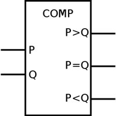

The aim of this experiment is to design and verify 2-bit magnitude comparator circuits, first with logic gates and then with a subtractor built from full adders, and to understand how the same principle extends to larger comparators.

### What you will learn:

Through this interactive experiment, you will:

- **Understand the fundamentals** of magnitude comparison of binary numbers and the three mutually exclusive outputs A > B, A = B and A < B
- **Analyze** the 1-bit comparator, the building block of larger comparators (studied in the theory and procedure)
- **Build a 2-bit comparator** from logic gates (XNOR, AND, OR and NOT), comparing the most significant bits first (Practice task 1)
- **Build a 2-bit comparator using a subtractor** made of two full adders, and see how the carry and the result of A − B give the comparison (Practice task 2)
- **See how the principle extends** to 4-bit and n-bit comparators (described in the theory, not built in the experiment)
- **Explore real-world applications** of comparators in processors, control systems, and digital circuits

### Why are comparators important?

Digital comparators are essential building blocks in digital systems. They are fundamental components not only in arithmetic logic units (ALUs), but also in control circuits, sorting algorithms, decision-making systems, and conditional operations in processors. Understanding comparator circuits will give you insight into how computers perform logical comparisons and make decisions based on numerical relationships.

_The block symbol of a comparator. In the symbol the two numbers are called P and Q; in this experiment they are called A and B._
