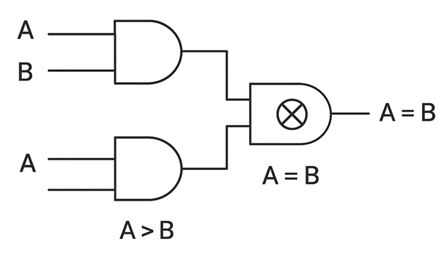
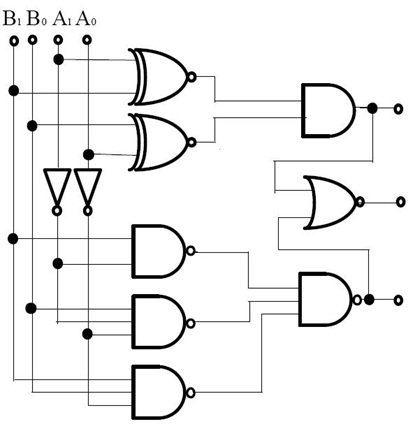
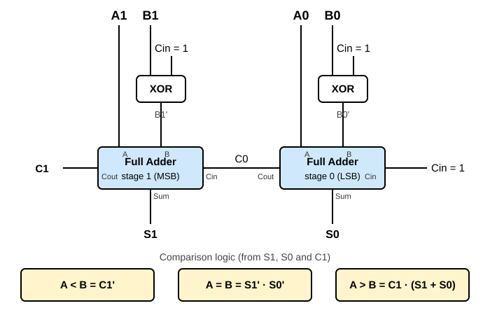

### 1-bit Comparator

#### Circuit Diagram

_Figure 1: 1-bit Comparator circuit diagram showing logic gates for A > B, A = B, and A < B outputs. The figure builds A = B with a NOR gate; the steps below build it with two AND gates and an OR gate, which gives the same function. Reference: Theory section_

**Note**: The Practice page has two tasks, the 2-bit comparator and the 2-bit comparator using a subtractor. The 1-bit comparator is described here for understanding and is the building block of the 2-bit comparator.

#### Components Required

- 4 AND gates
- 1 OR gate
- 2 NOT gates

#### Circuit Connections

1. Drag the first NOT gate and connect its input with B input. This creates B̄ (NOT B).
2. Drag the first AND gate and connect its inputs with A input and the output of the first NOT gate (B̄). Connect its output with the A > B output bit.
3. Drag the second NOT gate and connect its input with A input. This creates Ā (NOT A).
4. Drag the second AND gate and connect its inputs with the output of the second NOT gate (Ā) and B input. Connect its output with the A < B output bit.
5. Drag the third AND gate and connect its inputs with A input and B input.
6. Drag the fourth AND gate and connect its inputs with outputs of both NOT gates (Ā and B̄).
7. Drag the OR gate and connect its inputs with outputs of the third and fourth AND gates. Connect its output with the A = B output bit.
8. Set the values of A and B inputs and click "Simulate" to observe the comparison results.

#### Observations

- Only one of the three outputs (A > B, A = B, A < B) will be high (1) at any given time.
- A > B output is high when A = 1 and B = 0.
- A = B output is high when both A and B have the same value (both 0 or both 1).
- A < B output is high when A = 0 and B = 1.

### 2-bit Comparator (Direct Logic Implementation)

#### Circuit Diagram

_Figure 2: 2-bit Comparator circuit diagram showing hierarchical comparison logic for A₁A₀ vs B₁B₀. Reference: Theory section_

#### Components Required

- 2 XNOR gates
- 7 AND gates
- 2 OR gates
- 4 NOT gates

**Note**: The input bits A₁, A₀, B₁, B₀ and the output bits A>B, A<B, A=B are pre-placed in the simulation workspace. Figure 2 shows the same comparator in sum-of-products form, which needs gates with three inputs; the steps below use the hierarchical form from the Theory section, which needs only gates with two inputs. An input bit or a gate output can be connected to several gates: drag a new wire from an output point that is already connected. A wire can be dragged from an output point to an input point or the other way round.

#### Circuit Connections

**For A = B Output:**

1. Drag the first XNOR gate and connect its inputs with A₁ and B₁ input bits. Its output is A₁ ⊙ B₁.
2. Drag the second XNOR gate and connect its inputs with A₀ and B₀ input bits. Its output is A₀ ⊙ B₀.
3. Drag an AND gate and connect its inputs with outputs of both XNOR gates. Connect its output with the A = B output bit.

**For A > B Output:**

4. Drag the first NOT gate and connect its input with B₁ input bit.
5. Drag an AND gate and connect its inputs with A₁ input and output of the first NOT gate. This represents A₁B₁'.
6. Drag the second NOT gate and connect its input with B₀ input bit.
7. Drag an AND gate and connect its inputs with A₀ input and output of the second NOT gate. This represents A₀B₀'.
8. Drag an AND gate and connect its inputs with the output of the first XNOR gate (A₁ ⊙ B₁) and the A₀B₀' term from step 7. This represents (A₁ ⊙ B₁) · A₀B₀'.
9. Drag an OR gate and connect its inputs with outputs from steps 5 and 8. Connect its output with the A > B output bit.

**For A < B Output:**

10. Drag the third NOT gate and connect its input with A₁ input bit.
11. Drag an AND gate and connect its inputs with output of the third NOT gate and B₁ input. This represents A₁'B₁.
12. Drag the fourth NOT gate and connect its input with A₀ input bit.
13. Drag an AND gate and connect its inputs with output of the fourth NOT gate and B₀ input. This represents A₀'B₀.
14. Drag an AND gate and connect its inputs with the output of the first XNOR gate (A₁ ⊙ B₁) and the A₀'B₀ term from step 13. This represents (A₁ ⊙ B₁) · A₀'B₀.
15. Drag an OR gate and connect its inputs with outputs from steps 11 and 14. Connect its output with the A < B output bit.
16. Set the values of A₁, A₀, B₁, and B₀ inputs by clicking on the input bits (each click toggles the bit between 1 and 0) and click "Simulate".

Only the output of the first XNOR gate (the MSBs) is used in steps 8 and 14. The LSB comparison A₀ ⊙ B₀ is used only for the A = B output.

#### Observations

- A = B output is high when binary number A₁A₀ equals B₁B₀, and the other two outputs show 0.
- A > B output is high when binary number A₁A₀ is greater than B₁B₀, and the other two outputs show 0.
- A < B output is high when binary number A₁A₀ is less than B₁B₀, and the other two outputs show 0.
- The MSB comparison takes priority over LSB comparison.
- If the circuit has been constructed correctly, a "Success" message will be displayed upon clicking "Submit".

### 2-bit Comparator Using Subtractor

#### Circuit Diagram

_Figure 3: 2-bit Comparator using Subtractor approach: two XOR gates invert B₁ and B₀, two full adders compute A₁A₀ - B₁B₀, and the comparison outputs are generated from S₁, S₀ and C₁. Reference: Theory section_

#### Components Required

- 2 Full Adders
- 2 XOR gates (for B input inversion)
- 3 NOT gates (for result analysis)
- 2 AND gates (for equality and greater-than detection)
- 1 OR gate (for greater-than detection)

**Note**: The input bits A₀, A₁, B₀, B₁ and Cin and the output bits A>B, A<B, A=B are pre-placed in the simulation workspace. The input bit **Cin is the constant logic 1** of this circuit: it inverts B in the XOR gates and it is the +1 of the 2's complement. Keep Cin at 1 (when you click "Submit", the circuit is always tested with Cin = 1). An input bit or a gate output can be connected to several components: drag a new wire from an output point that is already connected.

#### Circuit Connections

**Subtractor Implementation:**

1. Drag the first XOR gate and connect its inputs with B₀ input and the Cin input bit (logic 1). Its output is B₀' (inverted B₀).
2. Drag the second XOR gate and connect its inputs with B₁ input and the Cin input bit (logic 1). Its output is B₁' (inverted B₁).
3. Drag the first Full Adder and connect:
   - A0 pin with the A₀ input bit
   - B0 pin with output of first XOR gate (B₀')
   - Cin pin with the Cin input bit (logic 1, for 2's complement +1)
   - Sum output is S₀
   - Cout connected to Cin of second Full Adder
4. Drag the second Full Adder and connect:
   - A0 pin with the A₁ input bit
   - B0 pin with output of second XOR gate (B₁')
   - Cin pin with Cout from first Full Adder
   - Sum output is S₁
   - Cout is C₁

**Comparison Output Generation:**

5. Drag the first NOT gate and connect its input with S₀.
6. Drag the second NOT gate and connect its input with S₁.
7. Drag an AND gate and connect its inputs with outputs of both NOT gates. Connect its output with A = B output bit. This represents S₁'S₀'.
8. Drag the third NOT gate and connect its input with C₁ (the Cout of the second Full Adder). Connect its output with A < B output bit.
9. Drag an OR gate and connect its inputs with S₀ and S₁. This represents S₁ + S₀ (the result is not zero).
10. Drag an AND gate and connect its inputs with C₁ and the output of the OR gate. Connect its output with A > B output bit. This represents C₁ · (S₁ + S₀).
11. Set the values of A₁, A₀, B₁, and B₀ inputs by clicking on the input bits (keep Cin at 1) and click "Simulate".

Do not connect C₁ directly to the A > B output bit: C₁ is also 1 when A = B, so A > B and A = B would both be high for equal numbers.

#### Observations

- The subtractor performs A₁A₀ - B₁B₀ using 2's complement arithmetic.
- A = B output is high when the subtraction result S₁ S₀ = 00 (zero result).
- A > B output is high when carry C₁ = 1 (no borrow occurred) and the result is not zero.
- A < B output is high when carry C₁ = 0 (borrow occurred, negative result).
- This method demonstrates the relationship between arithmetic and comparison operations.
- If the circuit has been constructed correctly, a "Success" message will be displayed upon clicking "Submit".

### Testing Procedures

#### 1-bit Comparator Testing

**Test Case 1:** A = 0, B = 0

- Expected: A = B = 1, A > B = 0, A < B = 0

**Test Case 2:** A = 0, B = 1

- Expected: A = B = 0, A > B = 0, A < B = 1

**Test Case 3:** A = 1, B = 0

- Expected: A = B = 0, A > B = 1, A < B = 0

**Test Case 4:** A = 1, B = 1

- Expected: A = B = 1, A > B = 0, A < B = 0

#### 2-bit Comparator Testing

**Test Case 1:** A₁A₀ = 01, B₁B₀ = 10

- Expected: A = B = 0, A > B = 0, A < B = 1 (1 < 2)

**Test Case 2:** A₁A₀ = 11, B₁B₀ = 10

- Expected: A = B = 0, A > B = 1, A < B = 0 (3 > 2)

**Test Case 3:** A₁A₀ = 10, B₁B₀ = 10

- Expected: A = B = 1, A > B = 0, A < B = 0 (2 = 2)

Run the same test cases with the subtractor-based comparator. For the equal numbers in test case 3 the carry C₁ is 1 but the result S₁S₀ is 00, so A > B must still be 0.

#### Troubleshooting

- **No Output Active**: Check that all gate connections are properly made and inputs are set correctly.
- **Multiple Outputs Active**: Verify the logic gate connections, particularly the NOT gates and their connections.
- **Incorrect Comparison Results**: For 2-bit comparator, ensure XNOR gates are used for bit equality and priority logic is correctly implemented.
- **Subtractor Method Issues**: Verify that B inputs are properly inverted and the +1 for 2's complement is applied to the first Full Adder's Cin. Make sure that the Cin input bit is 1.
- **A > B and A = B both high for equal numbers (subtractor method)**: C₁ was connected directly to the A > B output. Use C₁ · (S₁ + S₀) instead.
